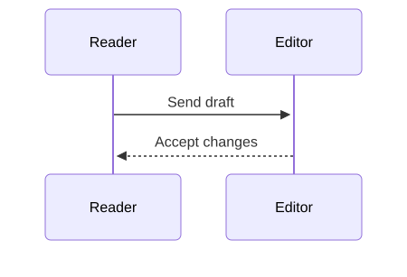
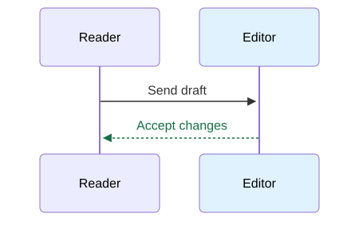

# Mermaid Sequence Palette

Color a participant and one chosen message in a rendered sequence diagram. The helper gives the selected line its own marker so other arrows that share the original arrowhead keep their original color.

**[English quickstart and step-by-step tutorial](TUTORIAL.md)**

[Download v0.1.1 ZIP](https://github.com/Uone100/mermaid-sequence-palette/releases/download/v0.1.1/mermaid-sequence-palette-0.1.1.zip)

Install in a Codex project with Node.js 22.20 or newer:

```sh
npx skills add Uone100/mermaid-sequence-palette -a codex
```

## Install as an Agent Skill

Download the **versioned ZIP** from [Releases](https://github.com/Uone100/mermaid-sequence-palette/releases/latest). Extract its contents into `.agents/skills/mermaid-sequence-palette/` in a Codex project or `.claude/skills/mermaid-sequence-palette/` in a Claude Code project. The installed folder should contain SKILL.md directly. Start a new session and ask for the task described above. You can also run the helper directly.

## How to color one arrow in a Mermaid sequence diagram

| Before | After |
| --- | --- |
|  |  |

Both diagrams come from [the same Mermaid source](examples/sample.mmd). The [palette rules](examples/colors.json) select the Editor participant and the Accept changes message. The Send draft arrow retains its original line and arrowhead.

## Worked example

Python 3.9+; an existing sequence SVG with named actor rectangles and paired sibling message labels and lines.

```sh
python scripts/palette.py examples/sample.svg examples/colors.json styled.svg
```

Expected: 1 actor box and 1 message in the small fixture. An actual renderer may draw a second box at the bottom. Duplicate message text requires an occurrence. This edits the SVG export, not Mermaid's native source syntax.

## Why it exists

[475 👍 on the upstream styling request](https://github.com/mermaid-js/mermaid/issues/523). [Mermaid's sequence documentation](https://mermaid.js.org/syntax/sequenceDiagram) documents shared classes for solid lines, dotted lines and message labels. This package applies rules by rendered box name and caption. Reaction counts were observed on 2026-11-20. They measure interest in the upstream request. This specific Skill's adoption is measured separately through its Release attachment.
